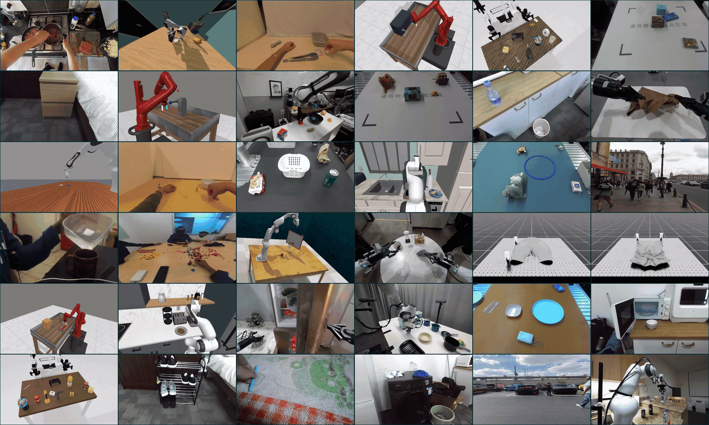
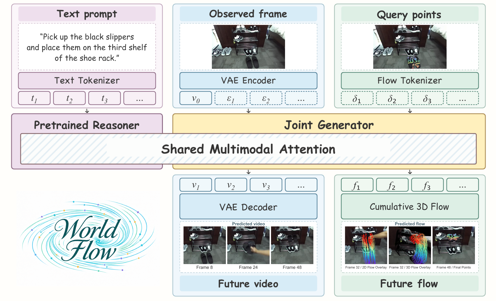

<p align="center">
  
</p>

<h1 align="center">WorldFlow: Joint Video and 3D Motion Prediction<br>via Large-Scale Pretraining</h1>

<p align="center">
  <a href="https://en.roboscience.co/">
    
  </a>
</p>

<p align="center">
  <a href="https://arxiv.org/pdf/2610.39278"></a>
  &nbsp;
  <a href="https://worldflow-rbs.github.io/"></a>
</p>

<p align="center"><b>Imagine the Future. Predict Its Motion.</b></p>

Official repository for **WorldFlow**, a generative world model that jointly predicts future video and query-conditioned 3D motion from a single RGB observation, a language instruction, and 3D query points.

> **WorldFlow** is dedicated to scaling the generalization of explicit 3D object kinematics. By bridging pixel-level evolution and a shared 3D motion space, it delivers highly robust, platform-independent 3D trajectory forecasting.

<p align="center">
  <a href="https://worldflow-rbs.github.io/#results">
    
  </a>
</p>

<p align="center">
  <a href="https://worldflow-rbs.github.io/#results">Explore qualitative results</a> ·
  <a href="https://worldflow-rbs.github.io/#real-robot">Real-robot demonstrations</a>
</p>

## News

- **2026-10-29:** Initial repository prepared with the paper, project overview, and visual assets.

## Highlights

- **Joint video and 3D motion generation.** A unified Mixture-of-Transformers (MoT) backbone jointly denoises video latents and continuous 3D displacement tokens with shared multimodal attention.
- **Geometry grounded in visual context.** Query-point geometry and spatiotemporal alignment connect explicit 3D motion to pretrained video representations.
- **Large-scale heterogeneous training.** Approximately **1.44 million object-level samples from 17 data sources** span simulation, real-world robot and human interactions, and in-the-wild motion.
- **WorldFlowBench.** **1,678 held-out samples from 11 data sources** evaluate simulated interactions, real-world motion, and spatial reasoning.
- **Flow as planning for downstream manipulation.** We evaluate a downstream control strategy that uses language-conditioned 3D object trajectories as motion plans. Separate grasping, trajectory optimization, and control modules translate these plans into real-robot execution.

## Overview

<p align="center">
  
</p>

WorldFlow extends the Cosmos-Nano framework with a generative 3D flow modality. The pretrained reasoner processes language, while the video VAE encodes the observed image. The generator jointly predicts future video latents and frame-to-frame 3D displacements at the query points. Rescaling and accumulating those displacements recovers metric trajectories in the **initial camera coordinate system**.

The predicted flow is an explicit model output; no separate tracking stage is required to recover it from the generated video. See Section 3 of the [paper](https://arxiv.org/pdf/2610.39278) for the representation, objectives, and model details.

## Results

### 3D Motion Forecasting on WorldFlowBench

WorldFlow achieves the **lowest ADE and FDE among the evaluated learning-based methods across all three subsets** of WorldFlowBench, covering 1,678 held-out samples from simulated interactions, real-world motion, and spatial-relation reasoning.

| Subset | Samples | ADE (m) ↓ | FDE (m) ↓ | PWT (0–1) ↑ |
|:--|--:|--:|--:|--:|
| Sim7 | 396 | 0.051 | 0.094 | 0.564 |
| Real3 | 882 | 0.081 | 0.113 | 0.311 |
| SpatialCog | 400 | 0.060 | 0.078 | 0.449 |

ADE and FDE measure position error in meters (m). PWT is a dimensionless hit rate between 0 and 1, averaged over distance thresholds of 1, 2, and 5 cm.

- **Comparison with external learned baselines.** WorldFlow reduces ADE by **46.9% on Sim7** (0.096 → 0.051 m), **4.7% on Real3** (0.085 → 0.081 m), and **54.2% on SpatialCog** (0.131 → 0.060 m), relative to the strongest external learned baseline on each subset.
- **Benefit of joint video-flow generation.** Compared with the flow-only variant, joint generation reduces ADE by **48.5%, 19.8%, and 55.9%** on Sim7, Real3, and SpatialCog, respectively. On SpatialCog, FDE falls from **0.248 to 0.078 m**, a **68.5% reduction**.
- **Direct flow generation versus post-hoc tracking.** Using the same WorldFlow-generated video, Track4World and 4RC yield SpatialCog ADEs of **0.083 m** and **0.098 m**, respectively, versus **0.060 m** for directly generated flow.

### Downstream Evaluation: Flow as Planning

We test the predicted object trajectories as motion plans in a shared grasping, trajectory optimization, and robot control pipeline. The evaluation spans **12 tasks with three trials per task, totaling 36 trials per method**.

| Flow predictor | Flow prediction success ↑ | Robot execution success ↑ |
|:--|--:|--:|
| μ₀ | 25.0% (9/36) | 11.1% (4/36) |
| **WorldFlow** | **97.2% (35/36)** | **66.7% (24/36)** |

Only the flow predictor changes between methods; paired trials use matched initial layouts, identical grasp results, and the same planning and control settings. Flow prediction and full robot execution are evaluated separately.

See Section 4 of the [paper](https://arxiv.org/pdf/2610.39278) for the complete baseline comparisons, ablations, and evaluation protocol.

## Release Plan

- [x] Paper, project introduction, and visual assets
- [ ] Model implementation and inference examples
- [ ] Model checkpoints and download instructions
- [ ] Training code and reproducible configurations
- [ ] Data preparation tools and WorldFlowBench evaluation tools
- [ ] Dataset and benchmark download instructions

Release links and executable instructions will be added when the corresponding artifacts become available.

## Citation

If you find this work useful, please cite:

```bibtex
@misc{lu2026worldflowjointvideo3d,
  title={WorldFlow: Joint Video and 3D Motion Prediction via Large-Scale Pretraining},
  author={Yuhao Lu and Jiongxu Chen and Hexiang Wei and Jiajin Wu and Juelin Li and Mingjian Liang and Fan Yang and Zhuowei Liang and Zihao Liu and Zhennan Wang and Sheng Wang and Lin Shao},
  year={2026},
  eprint={2610.39278},
  archivePrefix={arXiv},
  primaryClass={cs.CV},
  url={https://arxiv.org/abs/2610.39278},
}
```

## Acknowledgments and Licensing

WorldFlow builds on [NVIDIA Cosmos](https://github.com/NVIDIA/cosmos) and [Cosmos Framework](https://github.com/NVIDIA/cosmos-framework). We thank the developers and dataset contributors supporting this research.

Third-party code, pretrained models, and datasets retain their respective licenses and access conditions. Licenses for the upcoming WorldFlow code, checkpoints, and data releases will be announced with those releases. This initial repository does not grant a new license for third-party materials.
